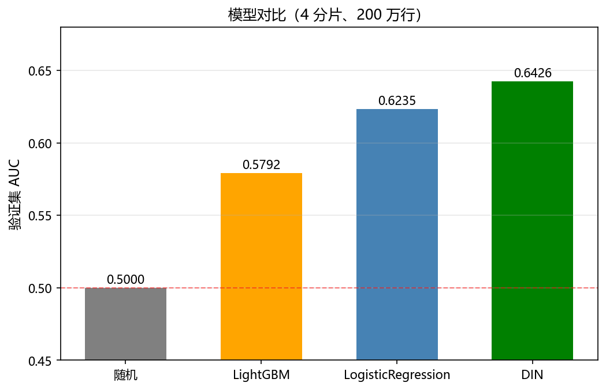
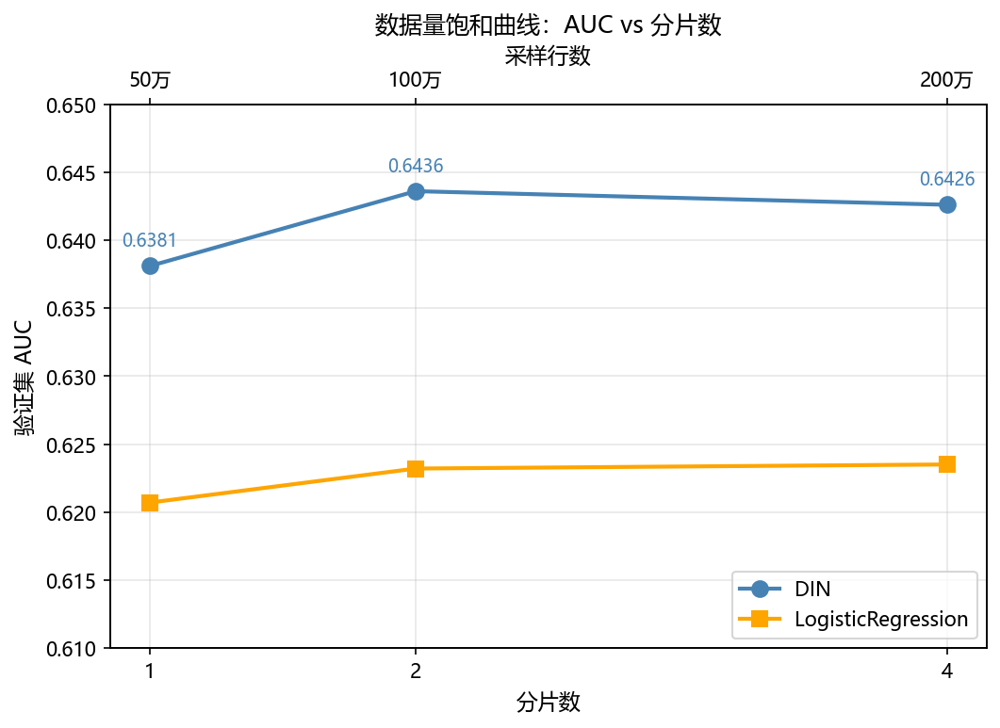

# Taobao-MM 多模态 CTR 预测

基于 [Taobao-MM](https://huggingface.co/datasets/Taobao-MM/Taobao-MM) 数据集，
用 **DIN（Deep Interest Network）+ SCL 多模态 embedding** 做点击率（CTR）预测。
通过受控消融实验定位关键超参，最终验证集 **AUC 0.6426**，超过 LR 基线 0.6235。

## 实验结果

| 模型 | 验证集 AUC | LogLoss |
|---|---|---|
| 随机（全局 CTR） | 0.5000 | 0.4004 |
| LightGBM | 0.5792 | 1.0436 |
| LogisticRegression | 0.6235 | 0.7007 |
| **DIN（最终）** | **0.6426** | — |



## 关键发现

1. **weight_decay 是关键超参**：从 `1e-3` 降到 `1e-4`，AUC 提升 **0.0554**。
   强 L2 正则会在训练早期破坏 SCL 预热的语义结构。
2. **词表大小要与数据量匹配**：`EMB_VOCAB` 从 200 万降到 20 万，AUC 持平，
   单 epoch 耗时从 22 分钟降到 3 分钟（**快 7 倍**）。
3. **数据量存在饱和点**：从 1 分片到 4 分片，AUC 在 2 分片（100 万行）后不再显著上升。
4. **序列方向不是瓶颈**：`HIST_TAKE=first` 与 `last` 无显著差异。



## 方法

- **数据**：Taobao-MM train 分片，取前 4 个分片，采样 200 万行。
  用户行为序列最长 1000，截断到 500。
- **多模态**：用 SCL 128 维向量预热 item embedding，再由点击信号端到端训练。
  高频物品进可训练词表（Top-K），稀有物品归并 `<unk>`，padding 单独占位。
- **模型**：DIN + target attention，局部激活单元 `[q, k, q-k, q*k]`。
  8 个类别特征走 embedding，类别不平衡用 `pos_weight` 处理。
- **基线**：LR 和 LightGBM，使用用户属性 + 候选商品属性 + 统计特征。

## 目录结构

```
.
├── README.md
├── REPRODUCE.md            # 详细复现指南
├── run_all.sh              # 一键复现脚本
├── requirements.txt
├── code/
│   ├── config.py           # 配置（路径、超参、列名映射）
│   ├── prepare.py          # 预处理：分片 → 截断 → 词表 → 落盘
│   ├── model_din.py        # DIN 模型训练
│   ├── train_baseline.py   # LR / LightGBM 基线
│   ├── feature_emb.py      # SCL 多模态向量加载
│   ├── score.py            # 离线推理验证
│   └── plot_results.py     # 实验可视化
└── figures/                # 实验结果图
```

## 环境要求

| 项目 | 最低要求 | 本项目实际使用 |
|---|---|---|
| 显存 | 4GB | 6GB |
| 内存 | 16GB | 16GB |
| 磁盘 | 10GB 可用 | 51GB 可用 |
| GPU | NVIDIA（CUDA） | 是 |
| Python | 3.9+ | 3.9 |
| PyTorch | 2.0+ | 2.x |

如果显存不足，调小 `BATCH`、`MAX_HIST`、`SAMPLE_ROWS` 或 `N_SHARDS`。

## 数据准备

从 [Hugging Face](https://huggingface.co/datasets/Taobao-MM/Taobao-MM) 下载 Taobao-MM，
只需要 `train/` 和 `feature_map/` 两部分。

```
你的数据目录/
├── train/
│   ├── train-shard-000000.parquet
│   └── ...（共 161 个分片）
└── feature_map/
    ├── scl_emb_int8_p90_keys.npy
    └── scl_emb_int8_p90_values.npy
```

设置环境变量：

```bash
export TAOBAO_TRAIN_DIR=/path/to/train
export TAOBAO_FEATUREMAP_DIR=/path/to/feature_map
```

## 一键复现

```bash
bash run_all.sh
```

脚本会依次执行预处理、基线训练、DIN 训练、离线推理验证、可视化。
详细步骤和常见问题见 [REPRODUCE.md](REPRODUCE.md)。

## 手动跑一轮完整实验

```bash
cd code

export RUN_ID=r008_4shards
export N_SHARDS=4
export SAMPLE_ROWS=2000000
export EMB_VOCAB=200000
export MAX_HIST=500
export HIST_TAKE=first
export EPOCHS=6
export BATCH=512
export DROPOUT=0.1
export WEIGHT_DECAY=1e-4

python prepare.py
python train_baseline.py
python model_din.py
python score.py
python plot_results.py
```

## 离线推理验证

```bash
cd code
export RUN_ID=r008_4shards
python score.py
```

## 预期输出

跑完 `run_all.sh` 后，关键输出如下：

| 阶段 | 关键指标 | 预期值 |
|---|---|---|
| prepare | 训练表行数 | 2,000,000 |
| prepare | SCL 命中率 | 1.000 |
| baseline | LR AUC | 0.6235 |
| baseline | LightGBM AUC | 0.5792 |
| DIN | 最终 valid AUC | 0.6426 |
| score | 推理 AUC 差异 | 0.000000 |

详细预期输出见 [REPRODUCE.md](REPRODUCE.md)。

## 环境限制与项目边界

**硬件**：6GB 显存、16GB 内存。受此限制，实验在 4 个分片（约 200 万行）上进行，
未跑全量 161 个分片。数据量饱和实验表明 2 分片后 AUC 不再显著上升。

**项目范围**：聚焦推荐系统的精排阶段（CTR 预测）。Taobao-MM 数据集是离线快照，
不含实时行为流、召回层和物品实时特征，因此不适用于端到端实时推荐系统。
本项目的精排模型实验方法论可迁移到线上系统。

## 复现的边界

**能复现的**：

- 代码逻辑和实验流程
- 在当前数据子集上的相对结论（DIN > LR > LightGBM）
- 超参消融的趋势（weight_decay、词表大小的影响）

**不能完全复现的**：

- 绝对 AUC 数字（取决于数据分片、硬件、随机性）
- 全量 161 个分片的结果（本项目受硬件限制只跑了 4 个）

## 技术栈

Python · PyTorch · PyArrow · Pandas · scikit-learn · LightGBM · Matplotlib

## License

MIT
